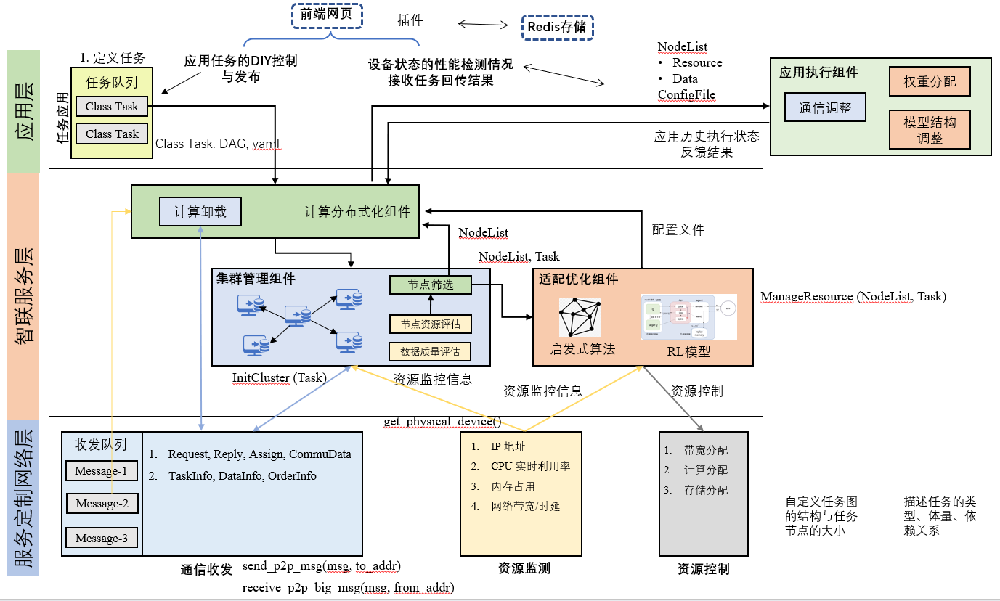
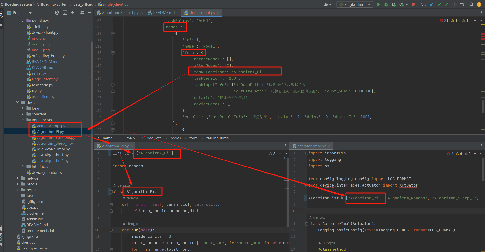
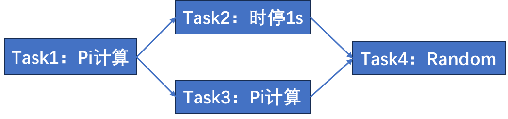
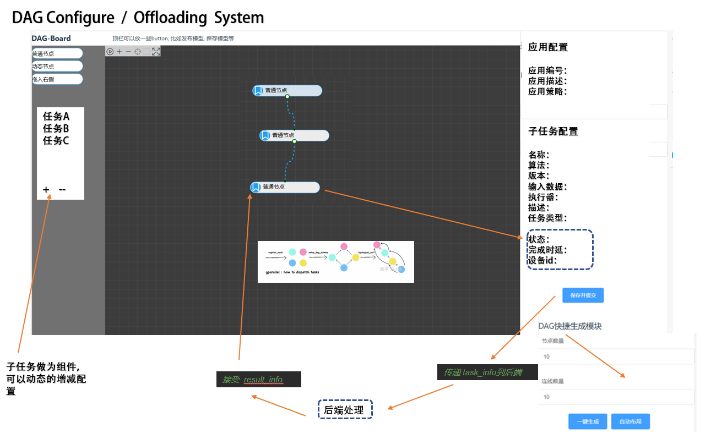

# DAG计算任务调度框架

## 系统框架



## 文件梳理
* README.md - 本文件 
* Jenkinsfile - 用以自动构建和测试的脚本
* Dockerfile - 用以自动构建 Docker 镜像的脚本
* requirements.txt - 依赖包文件
* server.py  - 用户端（底座）：
      1.监听并维护接入的边缘设备，
      2.对user_client的消息进行卸载决策；
      3.根据决策分发至不同的device_client进行处理；
      4.连接redis记录相关信息；
* user_client.py  -  用户端（应用层）：通过Flask框架与DAG WEB端进行交互，接受来自WEB端的DAG算法请求，并发送至server进行卸载决策；
* device_client.py  -  边缘设备端：连接server，接收并处理来自server的子任务，返回result
* task_form.py  -  设置task的格式（与前端之间进行交互设计）
* device_form.py  -  设定device的消息格式（与前端之间进行交互设计）
* offloading_brain.py - 智能化的卸载决策（负责具体的任务调度）# To be developed

## 项目运行
<!-- 1. 安装依赖(pip)
         $ pip install -r requirements.txt -->
1.构建docker镜像
docker build --progress=plain -t opensai-offloading:latest .

2. 启动redis服务器；（redis server即可）
    
3. 依次启动不同的设备服务：
   $ python server.py
   $ python device_client.py
   $ python single_client.py     # 传输单次任务请求(仅测试用，若开启前端交互则不用启动)
    

4. 前端交互（可选）
   4.1. 启动Web端项目 OffloadingWeb
   4.2. 运行client 
   $ python user_client.py 

   4.3. 按流程 选择 + 定制 dag任务图结构，之后将通过相应的执行逻辑返回不同的结果； 

6. 查看任务日志，获取任务执行结果与任务处理流程。


## DAG msg request   用户请求卸载DAG的格式数据
```python
dag_data = {'dagData':
    {'taskName': 'app123',            # 任务名
    'taskId': '1',                  # 任务id
    'taskDesc': '协同感知任务',       # 任务描述
    'taskCreateTime': 1, #生成时间
    'taskPolicy': '策略1',          # 策略名
    'nodes':                       # 子任务组
    [{
        'id': 1,                   # 子任务id
        'name': 'Node1',           # 子任务名称
        'form': {
            'beforeNodes': [],     # 前置子任务
            'afterNodes': [],     # 后置子任务
            'taskAlgorithm': 'Algorithm_Pi_Calculation',    # 算法名称
            'taskVersion': '1.0',                  # 算法版本
            'taskInputInfo': {"inDataPath": '待执行任务取数据位置', "outDataPath":'待执行任务产生数据的位置' ,"count_num":100000},  
             # 算法函数的输入参数，可自定义dict，如count_num为algorithm_taskPi的输入参数，执行100000次pi计算
            'details': '描述子任务信息1',
            'directAllocationId': -1,   # 前端指定卸载设备
            'deviceParam': {}
            },
        'result': {
            "taskResultInfo":'任务结果',    # 算法回传结果
            'status': 1,                  # 子任务状态
            'delay': 0,                   # 任务时延
            'deviceId': 1001              # 卸载设备id号
            }
    }]
}}
```

其中，key 'nodes' 对应的value为子任务详细信息列表，每一个元素对应一个子任务的具体配置，上述注释有详细说明；


## 算法配置
不同应用需要自行【设计并实现】相应的算法文件，存放在 ./device/implements/ 文件夹下
配置dag节点时，任务节点中的taskAlgorithm的值对应./device/implements/ 文件夹下的同名文件，这样才能帮助索引到对应的任务实现。

假设要实现一个pi计算任务的demo：Algorithm_Pi.py ，创建流程：
1.实现Algorithm_Pi.py
2.把新实现算法加入server的算法列表，即在actual_impl.py的AlgorithmList里添加
3.按同名规范使用'Algorithm_Pi'
4.通过'taskInputInfo'配置输入参数，如pi计算中的计算次数"count_num"，值越大，计算结果越接近pi



如果有跨节点存取数据的需求，即子任务2需要取子任务1中的数据，需配置节点数据存储路径，并自行实现.py执行文件中数据的存取路径，可以通过dag节点间的配置，实现相应的文件存取；
配置nodes中每个node的'taskInputInfo': {"inDataPath": '待执行任务取数据位置', "outDataPath":'待执行任务产生数据的位置'}


### nodes的配置示例

```python
dag_data = {'dagData':
                    {'taskName': 'app123',
                     'taskId': '1',
                     'taskDesc': '协同感知任务',
                     'taskCreateTime': time.time(),
                     'taskPolicy': 1,
                     'nodes':
                         [{
                             'id': 1,
                             'name': 'Node1',
                             'form': {
                                 'beforeNodes': [],
                                 'afterNodes': [2],
                                 'taskAlgorithm': 'Algorithm_Pi_Calculation',
                                 'taskVersion': '1.0',
                                 'taskInputInfo': {"inDataPath": './data/',
                                                   "outDataPath": './data/',
                                                   "DataSize": 50,
                                                   "isExit": 0,
                                                   "model_name": "model.pth", "scale_num": 100, "num_epochs": 50},
                                 'details': '描述子任务信息1',
                                 'directAllocationId': -1,
                                 'deviceParam': {}
                             },
                             'result': {"taskResultInfo": '任务结果', 'status': 1, 'delay': 0, 'deviceId': 1001}
                         },
                             {
                                 'id': 2,
                                 'name': 'Node2',
                                 'form': {
                                     'beforeNodes': [1],
                                     'afterNodes': [],
                                     'taskAlgorithm': 'Algorithm_Sleep_1',
                                     'taskVersion': '1.0',
                                     'taskInputInfo': {"inDataPath": './data/',
                                                       "outDataPath": './data/',
                                                       "DataSize": 40,
                                                       "isExit": 1,
                                                       "model_name": "model.pth", "scale_num": 100, "count_num": 1000},
                                     'details': '描述子任务信息1',
                                     'deviceParam': {},
                                     'directAllocationId': -1
                                 },
                                 'result': {"taskResultInfo": '任务结果', 'status': 1, 'delay': 0, 'deviceId': 1001}
                             }
                         ]
                     }}
```


```python

dag_data = {'dagData':
                    {'taskName': 'app1',
                     'taskId': '1',
                     'taskDesc': '',
                     'taskCreateTime': time.time(),
                     'taskPolicy': '策略1',
                     'nodes':
                         [{
                             'id': 1,
                             'name': 'Node1',
                             'form': {
                                 'beforeNodes': [],
                                 'afterNodes': [2,3],
                                 'taskAlgorithm': 'Algorithm_Pi_Calculation',
                                 'taskVersion': '1.0',
                                 'taskInputInfo': {"inDataPath": './data/',
                                                   "outDataPath": './data/', "count_num": 10000000},
                                 'details': '描述子任务信息1',
                                 'directAllocationId': -1,
                                 'deviceParam': {}
                             },
                             'result': {"taskResultInfo": '任务结果', 'status': 1, 'delay': 0, 'deviceId': 1001}
                         },
                         {
                             'id': 2,
                             'name': 'Node2',
                             'form': {
                                 'beforeNodes': [1],
                                 'afterNodes': [4],
                                 'taskAlgorithm': 'Algorithm_Sleep_1',
                                 'taskVersion': '1.0',
                                 'taskInputInfo': {"inDataPath": './data/',
                                                   "outDataPath": './data/', "sleep_time":1 },
                                 'details': '描述子任务信息1',
                                 'directAllocationId': -1,
                                 'deviceParam': {}
                             },
                             'result': {"taskResultInfo": '任务结果', 'status': 1, 'delay': 0, 'deviceId': 1001}
                         },
                        {
                             'id': 3,
                             'name': 'Node3',
                             'form': {
                                 'beforeNodes': [1],
                                 'afterNodes': [4],
                                 'taskAlgorithm': 'Algorithm_Pi_Calculation',
                                 'taskVersion': '1.0',
                                 'taskInputInfo': {"inDataPath": './data/',
                                                   "outDataPath": './data/', "count_num": 10000000},
                                 'details': '描述子任务信息1',
                                 'directAllocationId': -1,
                                 'deviceParam': {}
                             },
                             'result': {"taskResultInfo": '任务结果', 'status': 1, 'delay': 0, 'deviceId': 1001}
                         },
                         {
                             'id': 4,
                             'name': 'Node4',
                             'form': {
                                 'beforeNodes': [2,3],
                                 'afterNodes': [],
                                 'taskAlgorithm': 'Algorithm_Random',
                                 'taskVersion': '1.0',
                                 'taskInputInfo': {"inDataPath": './data/',
                                                   "outDataPath": './data/'},
                                 'details': '描述子任务信息1',
                                 'directAllocationId': -1,
                                 'deviceParam': {}
                             },
                             'result': {"taskResultInfo": '任务结果', 'status': 1, 'delay': 0, 'deviceId': 1001}
                         }
                         ]
                     }}
```

## 项目前端页面

