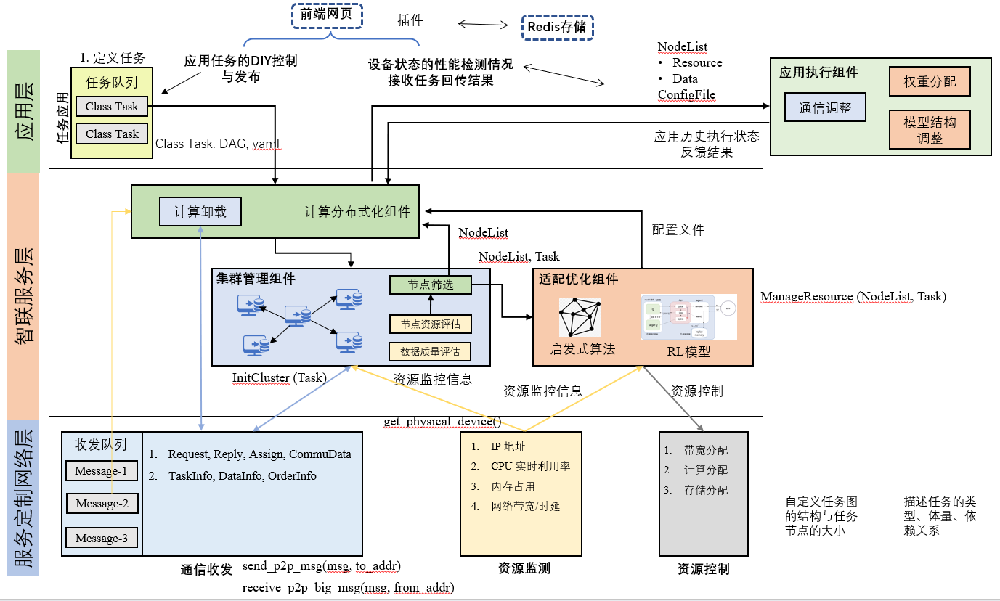

# OpenSAI — DAG 计算卸载平台（使用指南）

OpenSAI 是一个面向 **DAG（有向无环图）计算任务**的协同卸载平台：你把一个任务拆成若干
有依赖关系的子任务（DAG），平台负责把这些子任务**调度并分发到不同的边缘设备**上执行，
再把结果按依赖顺序汇总返回。系统分三层：**应用层**（定义/发布任务、查看结果）、
**智联服务层**（计算卸载决策、调度）、**服务定制网络层**（设备通信、资源监测与控制）。

> 这是给**第一次接触本系统**的人看的快速上手指南。想了解“系统怎么设计、能做什么、
> 哪些还没做”，请看 [docs/ARCHITECTURE.md](docs/ARCHITECTURE.md)。

## 系统架构图



---

## 1. 环境要求

- **Windows 10/11** + **Python 3.13**（已验证）。无需管理员权限。
- 不需要预装 Redis 或 Docker：
  - **Redis** 由安装脚本自动下载便携版（仅 server 所在机器需要）。
  - **Docker 可选**：装了就用容器执行任务（带 CPU/内存限制）；没装会**自动降级为本地执行**。
- 跑深度学习算法（CNN/Train）才需要额外的 `torch` 和 CIFAR-10 数据（见 §6）。

> 目前一键脚本是 PowerShell 版（Windows）。Linux 下可参考脚本里的命令手动执行。

## 2. 快速开始（三步）

在仓库根目录 `D:\opensai-master` 下：

```powershell
# ① 一次性安装：建虚拟环境 .venv、装核心依赖、下载便携版 Redis
powershell -ExecutionPolicy Bypass -File scripts\setup.ps1

# ② 启动整套：Redis + server + 1 个 device（幂等，可重复执行）
powershell -ExecutionPolicy Bypass -File scripts\run.ps1

# ③ 端到端自检：提交一个 Pi→Sleep 的 DAG，看是否跑通
powershell -ExecutionPolicy Bypass -File scripts\smoke_test.ps1
```

看到 `SMOKE TEST: PASS`（含 `Node1 pi≈3.14`）就说明整条链路正常。

停止：`powershell -ExecutionPolicy Bypass -File scripts\stop.ps1 -All`
（不加 `-All` 只停 server/device/web，保留 Redis）。

脚本细节见 [scripts/README.md](scripts/README.md)。

## 3. 提交一个 DAG 任务

### 方式 A：命令行（最简单，适合自测/脚本化）

`scripts\inject_dag.py` 就是一个最小注入器（也是冒烟测试用的）。它向 server 提交一个
两节点 DAG（`Algorithm_Pi_Calculation` → `Algorithm_Sleep_1`）并打印结果。直接：

```powershell
.\.venv\Scripts\python.exe scripts\inject_dag.py
```

照着它改 `dag_data` 就能提交你自己的 DAG。也可参考更完整的示例
`Offloading-System\dag_offload\single_client.py`。

### 方式 B：Web 前端（可视化拖拽，适合演示）

见 §5。

### DAG 数据格式（核心）

一个 DAG 任务是这样的 JSON（关键字段）：

```python
dag_data = {'dagData': {
    'taskName': 'app1',                 # 任务名
    'taskId': '1',
    'taskCreateTime': time.time(),      # 时间戳（float）或 "YYYY-mm-dd HH:MM:SS"
    'taskPolicy': '策略1',
    'nodes': [                          # 子任务列表（节点）
        {
            'id': 1, 'name': 'Node1',
            'form': {
                'beforeNodes': [],              # 前驱节点 id（依赖谁）
                'afterNodes': [2],              # 后继节点 id（谁依赖我）
                'taskAlgorithm': 'Algorithm_Pi_Calculation',  # 算法名（见 §4）
                'taskVersion': '1.0',
                'taskInputInfo': {              # 传给算法 run() 的参数 dict
                    'inDataPath': './data/', 'outDataPath': './data/',
                    'count_num': 500000
                },
                'directAllocationId': -1,       # -1=随机分配设备；>0=指定第 N 个设备
                'deviceParam': {},
                'containerConfig': {'cpu_cores': 2.0, 'memory_mb': 2048}  # 可选：Docker 资源
            },
            'result': {'taskResultInfo': '', 'status': 1, 'delay': 0, 'deviceId': 1001}
        },
        # ... Node2，beforeNodes=[1] 表示它依赖 Node1 ...
    ]
}}
```

- `beforeNodes` / `afterNodes` 描述依赖关系；server 按依赖顺序调度（前驱全完成才就绪）。
- `taskInputInfo` 整个 dict 会作为 `param_dict` 传给算法的 `run()`。
- 更详细的多节点示例（含分支/汇聚）见
  [Offloading-System/dag_offload/README.md](Offloading-System/dag_offload/README.md)。

> 跨设备数据：上游节点写到约定路径 `param_dict['_artifact_out']` 的产物，会经 **QUIC 数据面**
> 自动拉取到下游节点所在的设备（注入为下游的 `param_dict['_artifact_in']`，是一个 `{前驱id: 本地文件}`
> 映射）。这正是“协同感知”流水线的基础——可运行示例见 [scripts/README.md](scripts/README.md) 的
> “Collaborative-perception demo”。（仅依赖关系、不走该约定的普通文件不会自动传输。）

## 4. 添加自定义算法

算法文件放在 `Offloading-System\device\implements\`，命名与写法约定：

1. 文件名以 `Algorithm` 开头，例如 `Algorithm_Foo.py`（这样才会被设备自动识别）。
2. 文件内：`__all__ = ['Algorithm_Foo']`，并定义**同名类** `Algorithm_Foo`。
3. 类的构造函数签名为 `__init__(self, param_dict, data_dict)`，并实现 `run(self)` 返回结果。

最小示例：
```python
# Offloading-System/device/implements/Algorithm_Foo.py
__all__ = ['Algorithm_Foo']

class Algorithm_Foo:
    def __init__(self, param_dict, data_dict):
        self.param = param_dict          # = DAG 节点里的 taskInputInfo
        self.data = data_dict
    def run(self):
        n = self.param.get('count_num', 100)
        return f"foo done x{n}"
```
然后在 DAG 节点里把 `taskAlgorithm` 写成 `'Algorithm_Foo'` 即可。

> 也可以通过 Web 前端的“上传 .py”功能上传算法（会保存到上述目录）。
> 现成算法：`Algorithm_Pi_Calculation` / `Algorithm_Random` / `Algorithm_Sleep_1`（纯 Python，开箱即用）；
> `Algorithm_CNN` / `Algorithm_NEW_CNN` / `Algorithm_Train`（需 `torch` + CIFAR-10 数据）。

## 5. 启动 Web 控制台（推荐）

```powershell
powershell -ExecutionPolicy Bypass -File scripts\run.ps1 -WithWeb
```
浏览器打开 **http://127.0.0.1:5000** 进入 **OpenSAI Console**：实时集群监控（含大脑账本）、
可视化编排并提交 DAG、查看放置/执行结果、在线调系统参数、管理算法。单文件前端
（`dag_offload/static/console.html`，无构建、不依赖外网），由 `user_client.py`（Flask）提供。
**详细图文使用说明见 [docs/CONSOLE.md](docs/CONSOLE.md)。** 旧版编译前端保留在
**http://127.0.0.1:5000/legacy** 。

## 6. 跑深度学习算法（可选）

```powershell
.\.venv\Scripts\python.exe -m pip install -r Offloading-System\requirements-ml.txt
# 并把 CIFAR-10 数据放到 Offloading-System\data\（数据较大，已被 git 忽略）
```

**协同感知 demo（跨设备协作，推荐先跑这个看效果）**：把一张 CIFAR 图切成左右两半，
两台设备各提取特征，特征经 QUIC 数据面传输后融合分类。先 `python scripts\train_collab.py`
训练一次，再 `python scripts\demo_collab.py 10` 演示。详见 [scripts/README.md](scripts/README.md)。

## 7. 适配优化与资源控制（Phase 2：按任务智能放置 + 分配算力/带宽）

这一层让平台“看资源、按需放置、按量分配”，全部由环境变量 / 节点参数开关，**默认即启用智能放置**。
机制与实现细节见 [docs/ARCHITECTURE.md](docs/ARCHITECTURE.md) §11–§15。

### 7.1 放置（WHERE：子任务放到哪台设备）

`OPENSAI_PLACEMENT` 选模式：`plan`（默认，整图前瞻就近规划）/ `smart`（自适应贪心）/
`random`（对照基线）。节点带 `directAllocationId>0` 时优先按手动指定。
调权重：`OPENSAI_W_XFER`（传输权重）、`OPENSAI_W_LOAD`（负载权重，↑更分散 / ↓更聚合）、
`OPENSAI_DEFAULT_BW_MBPS`（未知链路兜底带宽）、`OPENSAI_PROBE_INTERVAL`（链路主动探测间隔秒，≤0 关）。

### 7.2 资源档位（HOW MUCH：给每个任务多少算力 / 内存 / 带宽）

可在 DAG 节点的 `taskInputInfo` 里**显式声明**，或让大脑**自动**决定（都会按设备“可用”收口、防超额）：

| 维度 | 节点显式声明 | 自动 | 设备执行机制 |
|---|---|---|---|
| CPU 核 | `cores: N` | 默认 = 总核 ÷ worker_slots | 进程池 worker `cpu_affinity` 绑核 |
| 内存 | `mem_mb: N`（= 运行基线**之上**的任务预算） | `OPENSAI_AUTO_MEM=1` 时按历史边际×2（地板 256MB） | 作业对象 / RLIMIT_AS 限“实时提交 + 预算” |
| 带宽 | `bw_mbps: N` | `OPENSAI_TARGET_XFER_S=秒` 时按 数据量 / 目标时延 自动算 | 令牌桶限速 + 出口公平平分 |

设备 / 出口预算旋钮：`OPENSAI_TASK_WORKERS`（每设备并行槽 = 进程池大小）、`OPENSAI_DEFAULT_CORES`、
`OPENSAI_DEVICE_BW_MBPS`（大脑侧每设备出口预算）、`OPENSAI_DATA_RATE_MBPS`（发送端出口预算，在并发流间公平平分）、
`OPENSAI_RESERVATION_TTL`（预留超时回收秒，默认 600）。

### 7.3 看监测 / 跑实验

```powershell
# 实时聚合监测视图（设备资源 + 大脑账本：预留/已承诺带宽/可用核/在飞/算法画像）
.\.venv\Scripts\python.exe scripts\show_monitor.py 10
```

量化实验脚本（放置 vs random、带宽/算力/内存分配、出口公平、多 DAG 争抢、异构容量等）一览见
[scripts/README.md](scripts/README.md) 的“Experiments”。

## 8. 多机部署

平台是 TCP 星型结构，可跨主机部署：每台 device 机器设环境变量 `OPENSAI_HOST` = server 的局域网 IP，
server 机放行 `8888`（控制面）、各 device 放行其 `OPENSAI_DATA_PORT`（数据面 QUIC/UDP）即可。
（真实多机部署下每台机器一个 device 进程，不会有单机多进程池的 spawn 拥塞问题。）

## 9. 项目结构

```
opensai-master/
├─ README.md                  ← 本文件（使用指南）
├─ scripts/                   ← setup/run/stop/smoke 脚本 + 演示/实验（见 scripts/README.md）
├─ docs/
│   ├─ CONSOLE.md             ← Web 控制台使用说明书
│   ├─ ARCHITECTURE.md        ← 系统架构 + Phase 2 实现详解（§11–§15，强烈建议通读）
│   └─ ROADMAP.md             ← Phase 2 路线图与进度（T 编号 WBS）
└─ Offloading-System/         ← 主系统
    ├─ dag_offload/           ← ★ 真正的入口
    │   ├─ server.py          ←  调度 + 放置决策 + 资源档位分配 + 分发中枢（TCP，:8888）
    │   ├─ device_client.py   ←  边缘设备执行端（心跳/监测、收子任务、绑核/限内存执行、回结果）
    │   ├─ run_device.py      ←  设备轻量启动器（避开 Windows 进程池 spawn 卡死）
    │   ├─ task_pool.py       ←  进程池 + 绑核 + 内存上限（算力资源控制 T4.2/B4）
    │   ├─ user_client.py     ←  Web/API 前端（Flask，:5000）
    │   └─ offloading_brain/  ←  放置决策：plan(前瞻) / smart(贪心) / random（RL 待做）
    ├─ network/dataplane/     ←  QUIC 设备间数据面（ArtifactServer 发送端 + fetch_blob；限速/出口公平）
    ├─ device/implements/Algorithm_*.py   ← 算法（含协同感知 FeatureExtract/Fusion + collab_model）
    ├─ device/interfaces/resource_control_interface.py  ← Docker 资源控制（可选/旧路径）
    ├─ predis/                ← Redis 设备注册表 / 服务层
    ├─ task/ result/ config/  ← 任务模型 / 结果模型 / 配置
    └─ requirements*.txt       ← core / -ml / -optional
```

## 10. 日志与常见问题

- **日志**：运行时日志在 `.run\server.err.log` / `.run\device.err.log`（git 忽略）。
- **必须用脚本/从仓库根目录启动**：`run.ps1` 会从仓库根目录拉起进程（保证路径正确）。
- **Redis 客户端必须是 5.0.x**：`requirements.txt` 已锁定。新版 redis-py 会用 RESP3 的
  `HELLO` 命令，老 Redis 不认且错误被静默吞掉 → 设备注册不上、任务不分发。
- **提示“无可用在线设备…等待重试”**：说明此刻没有 device 在线，先 `run.ps1` 起一个 device；
  任务会在设备上线后自动继续（不会崩）。
- **端口 8888 被占**：`stop.ps1 -All` 清干净再 `run.ps1`。

## 11. 文档与版本

- Web 控制台使用说明：[docs/CONSOLE.md](docs/CONSOLE.md)
- 架构与 Phase 2 实现详解：[docs/ARCHITECTURE.md](docs/ARCHITECTURE.md)（§11–§15）
- 路线图与进度：[docs/ROADMAP.md](docs/ROADMAP.md)
- 脚本 / 演示 / 实验：[scripts/README.md](scripts/README.md)

版本（git tag）：`v1.1-inherited`（接手原样）→ `v1.1.1`（可复现+止血修复）→
`v1.1.2`（死代码清理 + 卸载健壮性 + 多机配置）。此后 **Phase 2**（未打 tag，见 ROADMAP）：
协同感知 QUIC 数据面、真实监测 + 聚合视图、自适应/前瞻放置、CPU/内存/带宽资源档位分配。
