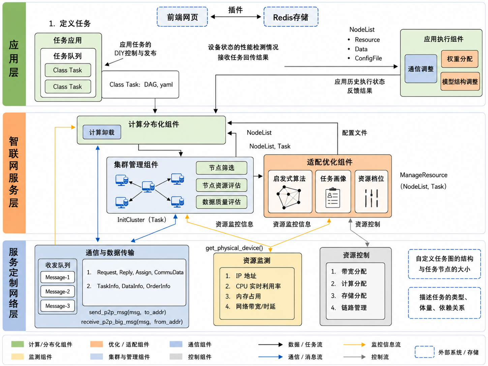

> 本文按 **三层架构 → 逐模块** 组织,逐个模块说明其**职责定义、实现要点、关键数据结构、对外接口(字段级)、相关配置**,并在关键处标注代码位置(`文件:符号`)。文档仅描述**当前已实现**的能力。

---

## 0. 文档信息

### 0.1 术语与缩略语

| 术语 | 含义 |
|---|---|
| DAG | 有向无环图，一个任务拆成的、带依赖关系的子任务图 |
| 子任务 / 节点 | DAG 的一个执行单元（对应一个算法 + 参数） |
| 放置 (placement) | 决定某子任务在哪台设备执行 |
| 资源档位 (allocation) | 分配给某子任务的 CPU 核 / 内存 / 带宽 / 存储 |
| 数据面 (data plane) | 设备间直传中间产物的 QUIC 通道 |
| 多链路 | 一次传输同时走多条物理路径（中继 / 多网卡）并行聚合 |
| 账本 (ledger) | 中枢内存中的资源预留 / 已承诺记录，用于防超卖 |
| makespan | 整张 DAG 的端到端完成时间 |
| 画像 (profile) | 算法历史资源/耗时统计（EWMA） |

### 0.2 阅读对象与范围
- 对象：研发、架构评审、运维。
- 范围：控制中枢（server）、设备端（device）、Web 桥接（user_client）、数据面（QUIC）、状态存储（Redis）。

---

## 1. 系统概述

### 1.1 平台定位
OpenSAI 是一个 **DAG 计算卸载平台**：用户把一个任务拆成有依赖关系的子任务（DAG），平台**智能决定每个子任务放到哪台设备、给它分配多少资源**，并在设备间通过数据面自动传输中间产物，最后按依赖汇总结果。面向**协同感知**等多设备协同计算场景。

### 1.2 总体架构图

{width=92%}

### 1.3 端到端流程（串起三层）
1. 应用层经 Web 桥接提交 DAG（`dagData`）→ 中枢入队并回 `dagRspStatus`。
2. **集群管理组件**为每个就绪子任务选设备（放置），**适配优化组件**为其定资源档位（`_alloc`）。
3. 中枢经控制面把子任务派发给目标设备；若子任务有前驱产物在别的设备，下发 `input_artifacts`（含拉取地址 / 多链路源）。
4. 设备执行器按档位（绑核 / 限内存）跑算法；需要前驱产物时经**数据面 QUIC**从上游设备拉取（同机则本地直读，跨设备且带宽不足时走多链路）。
5. 设备回 `dag_subtask_rsp`（结果 + 实测 metrics）；中枢释放该子任务的资源预留、更新画像、触发后继。
6. 整图完成 → 中枢汇总 `dagResult` 回传应用层，并通知相关设备清理产物。

### 1.4 部署形态与进程
| 进程 | 文件 | 默认端口 | 角色 |
|---|---|---|---|
| 控制中枢 | `dag_offload/server.py` | TCP `:8888` | 调度 + 放置 + 资源档位 + 分发 |
| 设备端 | `dag_offload/device_client.py`（`run_device.py` 启动） | 数据面 `:9999`+ | 心跳/监测、执行、资源控制、数据传输 |
| Web 桥接 | `dag_offload/user_client.py` | HTTP `:5000` | 浏览器 ↔ 中枢 |
| 状态存储 | Redis | `:6379` | 设备信息 / 在线集 / 监控视图 |

### 1.5 技术栈
Python；TCP（控制面）；`aioquic`（数据面 QUIC）；Redis（状态）；`psutil` / `threadpoolctl`（监测与资源控制）；进程池（`concurrent.futures.ProcessPoolExecutor`）。

---

## 2. 应用层

### 2.1 层职责与模块构成
负责**任务定义与发布、结果与监控展示**。模块：任务应用（DAG 定义）、Web 桥接服务、运行结果与监控展示。

### 2.2 任务应用（DAG 定义）
- **① 职责**：把计算任务描述成 DAG（节点 + 依赖 + 参数 + 资源档位 + 可选固定设备），提交给中枢。
- **② 实现**：DAG 为结构化 JSON；最小注入器见 `scripts/inject_dag.py` / `scripts/inject_collab.py`（`_node()` 构造节点）。
- **③ 关键数据结构 — DAG 提交体 `dagData`（字段级）**：

| 字段 | 类型 | 说明 |
|---|---|---|
| `dagData.taskName` | string | 任务名 |
| `dagData.taskId` | string | 任务标识（业务侧） |
| `dagData.taskCreateTime` | float | 创建时间（epoch 秒） |
| `dagData.taskPolicy` | string | 策略标记 |
| `dagData.nodes[]` | array | 节点列表 |
| `nodes[].id` | int | 节点 id（从 1 起，**须按升序排列**，中枢以 `queue[id-1]` 索引） |
| `nodes[].name` | string | 节点名 |
| `nodes[].form.beforeNodes[]` | int[] | 前驱节点 id（决定依赖与数据流） |
| `nodes[].form.afterNodes[]` | int[] | 后继节点 id |
| `nodes[].form.taskAlgorithm` | string | 算法名（见 §5.7 / 附录 C） |
| `nodes[].form.taskVersion` | string | 算法版本 |
| `nodes[].form.taskInputInfo` | object | 传给算法 `run()` 的参数 dict（含算法自身参数 + 资源档位） |
| `taskInputInfo.inDataPath/outDataPath` | string | 数据目录 |
| `taskInputInfo.cores` | int | 可选，声明 CPU 核档位 |
| `taskInputInfo.mem_mb` | int | 可选，声明内存预算（MB） |
| `taskInputInfo.bw_mbps` | float | 可选，声明传输带宽（MB/s） |
| `taskInputInfo.storage_mb` | int | 可选，声明存储配额（MB） |
| `nodes[].form.directAllocationId` | int | `-1`=自动放置；`>0`=固定到第 N 台设备 |
| `nodes[].form.deviceParam` | object | 预留 |
- **④ 对外接口**：提交 = 向中枢发送 `{"dagData": {...}}`（经桥接）。`task_id = taskName + str(taskCreateTime)`（`server.py` 内 `dagData` 处理）。
- **⑤ 配置**：无（纯数据）。

### 2.3 Web 桥接服务（user_client）
- **① 职责**：浏览器 ↔ 中枢的中介，持有一条到中枢的常驻 TCP 连接，把 HTTP 请求翻成中枢的 TCP/JSON 报文并回传。
- **② 实现**：Flask，`:5000`（`dag_offload/user_client.py`）。
- **③ 关键数据结构**：用户注册报文 `user_beat`。
- **④ 对外接口**：
  - 用户注册：`{"user_beat": {"name": "<user>"}}` → 中枢登记该连接（`server.py` 内 `user_beat` 处理）。**结果回传定位依赖它，须先发**。
  - 提交 DAG：见 §2.2；中枢即回 `{"dagRspStatus": true}`（`server.py` 内 `dagData` 处理），随后异步回 `dagResult`。
  - 基础信息查询：`{"devicesInfo":"data"}` / `{"algorithmsInfo":"data"}` / `{"policiesInfo":"data"}`（`server.py` 内 `*Info` 查询处理）。
- **⑤ 配置**：中枢地址 `OPENSAI_HOST` / `OPENSAI_PORT`。

### 2.4 运行结果与监控展示
- **① 职责**：展示任务结果与集群实时态势。
- **② 实现**：结果来自中枢 `dagResult`；监控来自 Redis 键 `OPENSAI_MONITOR_VIEW`（见 §3.5）。
- **③ 关键数据结构 — `dagResult`（字段级，`server.py:summarize_task_result`）**：

| 字段 | 类型 | 说明 |
|---|---|---|
| `dagResult.taskName` | string | = task_id |
| `dagResult.finishedTime` | float | makespan（秒） |
| `dagResult.nodes[]` | array | 各子任务结果 |
| `nodes[].id` / `name` | int / string | 节点标识 |
| `nodes[].taskAlgorithm` | string | 算法名 |
| `nodes[].taskInputInfo` | object | 节点入参（含最终 `_alloc`） |
| `nodes[].ResultInfo` | any | 算法返回值；出错时为 `"ERROR: ..."` 串 |
| `nodes[].result.status` | int | 子任务状态码 |
| `nodes[].result.delay` | float | 该子任务耗时（秒） |
| `nodes[].result.deviceId` | string | 放置到的设备（设备名） |
- **④ 对外接口**：跨设备传输数 = 统计 `beforeNodes` 边中两端 `deviceId` 不同的条数（前端计算）。
- **⑤ 配置**：监控刷新周期由前端决定（建议 ~2s）。

---

## 3. 智联网服务层（决策中枢 server）

### 3.1 层职责与模块构成
中枢负责**调度分发、放置决策、资源档位决策、状态聚合**。模块：计算分布化（调度中枢）、集群管理（放置）、适配优化（画像 + 档位）、监测聚合发布、产物生命周期协调、Redis 状态存储、控制面协议。核心类 `UserServer`（`dag_offload/server.py`）。

### 3.2 计算分布化组件（计算卸载 / 调度分发中枢）
- **① 职责**：DAG 解析与拓扑管理、就绪子任务的调度循环、向设备派发、收结果、触发后继、整图完成汇总。
- **② 实现**：
  - 子线程 1「卸载决策」：遍历就绪子任务调用放置（`server.py:offloading_strategy`）。
  - 子线程 2「就绪派发」：`server.py:handle_ready_subtasks` 取就绪子任务，构造 `input_artifacts` + 注入 `_alloc`，下发设备。
  - 收 `dag_subtask_rsp` → 标记完成、释放账本、更新画像、触发后继、整图完成回 `dagResult`（`server.py` 内 `dag_subtask_rsp` 处理）。
- **③ 关键数据结构**：`all_task_dict[task_id] = {"queue":[子任务...], "time": 入队时间戳}`；`all_task_decoded[task_id]`（原始 DAG）。
- **④ 对外接口**：见 §3.8 控制面协议（派发 P2P 报文、`dag_subtask_rsp`）。
- **⑤ 配置**：无。

### 3.3 集群管理组件（决定"卸载给谁"）
- **① 职责**：为每个子任务选执行设备（放置）。
- **② 实现**（`server.py` + `offloading_brain/offloading_brain.py`）：
  - **入口** `server.py:offloading_strategy`：`directAllocationId>0` → 直接放置（`direct_strategy`）；否则按 `OPENSAI_PLACEMENT` 选策略。
  - **健康预筛**：取设备表后先 `_healthy_devices`（`server.py`）过滤过载设备（CPU/内存/队列阈值，复用 `IdleDeviceImpl.idle_devices`）；全过载则退回全量（绝不阻塞放置）。手动钉选不过滤。
  - **三种策略**：
    - `plan`：整图反向就近规划，提交首次放置时一次规划并缓存（`OffloadingImpl.plan_dag`）。
    - `smart`：逐节点贪心（`locality_strategy`）。
    - `random`：随机（对照基线）。
  - **代价模型**（`offloading_brain.py:locality_strategy`）：`cost(d) = W_XFER·Σ传输秒 + W_LOAD·(预留数/worker_slots)`；传输秒 = 链路时延 + 数据量/实测带宽（用 `observed_links`）。体现**就近**（数据所在机传输秒=0）与**容量感知**（按并行槽位折算负载）。
  - **节点筛选 / 节点资源评估**：健康预筛 + 容量感知（核/内存/槽位/负载）即上述实现。
  - **放置预留账本**：放置成功 → `reservations[device_no] += 1`（`server.py:offloading_strategy` 尾）；完成 → `-1`（`dag_subtask_rsp`）；超时 → `_reclaim_stale_reservations` 回收。
- **③ 关键数据结构**：`reservations: {device_no: int}`；`placement_plan: {task_id: {node_id: device_no}}`；`output_sizes: {(task_id,node_id): bytes}`（前驱实测产出，供按真实数据量估传输代价）。
- **④ 对外接口**：`offloading_strategy(subtask) -> device_dict`；`plan_dag(decoded, device_info_list, reservations)`；`locality_strategy(device_info_list, subtask, pred_info, reservations)`。
- **⑤ 配置**：`OPENSAI_PLACEMENT`(plan/smart/random)、`OPENSAI_W_XFER`、`OPENSAI_W_LOAD`、`OPENSAI_HEALTH_FILTER`、`OPENSAI_RESERVATION_TTL`。

### 3.4 适配优化组件（决定"给多少资源"）
- **① 职责**：基于任务画像，为每个子任务确定四维资源档位（核 / 内存 / 带宽 / 存储），并记账防超卖。
- **② 实现**：
  - **任务画像**：`algo_history[algo] = {peak_mem_mb, task_mem_mb, proc_secs, task_storage_mb, n}`，按设备上报 metrics 做 EWMA（`_update_algo_history`，`server.py`，α=0.5）。
  - **资源档位决策** `server.py:_alloc_compute`：
    - 核：节点声明 `cores` → 否则 `OPENSAI_DEFAULT_CORES` → 否则设备默认；按设备可用核收口。
    - 内存：节点声明 `mem_mb`；或开 `OPENSAI_AUTO_MEM` 时按历史边际内存×2、地板 256MB 自动定档；按设备空闲内存收口。
    - 带宽：见 `server.py:_artifact_rate_mbps`——声明 `bw_mbps`；或开 `OPENSAI_TARGET_XFER_S` 时按「前驱实测产出 / 目标时延」自动估算；按源设备出口预算 `OPENSAI_DEVICE_BW_MBPS` 收口。
    - 存储：节点声明 `storage_mb`；或开 `OPENSAI_AUTO_STORAGE` 时按历史产出×2、地板 256MB；按设备空闲磁盘收口。
  - **已承诺资源账本**：`committed_bw[device_no]`（出口带宽）、`committed_storage_mb[device_no]`（存储）；分配即扣、完成即还（`dag_subtask_rsp`）、超时回收（`_reclaim_stale_reservations`）。
- **③ 关键数据结构 — `_alloc`（注入子任务 `param_dict['_alloc']`，字段级）**：

| 字段 | 类型 | 说明 |
|---|---|---|
| `cores` | int / null | CPU 核档位（null=设备默认） |
| `mem_budget_mb` | int / null | 内存预算（任务边际，worker 端上限=基线+预算） |
| `est_mem_mb` | int / null | 历史预估边际内存（记账用） |
| `storage_budget_mb` | int / null | 存储配额（MB） |

  - 账本结构：`committed_bw / bw_reservations[(task_id,node_id)]`、`committed_storage_mb / storage_reservations[(task_id,node_id)]`、`inflight[(task_id,node_id)]=(device_no, ts)`。
- **④ 对外接口**：`_alloc_compute(sub_task_info, dev_dict) -> _alloc`；`_artifact_rate_mbps(sub_task_info, src_device_no, pred_node_id) -> rate|None`。
- **⑤ 配置**：`OPENSAI_AUTO_MEM`、`OPENSAI_TARGET_XFER_S`、`OPENSAI_AUTO_STORAGE`、`OPENSAI_DEVICE_BW_MBPS`、`OPENSAI_MIN_BW_MBPS`、`OPENSAI_DEFAULT_CORES`、`OPENSAI_TASK_MEM_MB`。

### 3.5 监测聚合与发布
- **① 职责**：把设备心跳（Redis）与中枢账本（内存）合并为一份权威快照供监控消费。
- **② 实现**：`server.py:aggregate_monitor_view`，每 ~5s 发布到 Redis 键 `OPENSAI_MONITOR_VIEW`（TTL 30s）。
- **③ 关键数据结构 — 监控视图（字段级，见 §5.6）**。
- **④ 对外接口**：Redis 键 `OPENSAI_MONITOR_VIEW`（JSON）。
- **⑤ 配置**：发布周期固定 ~5s。

### 3.6 产物生命周期协调
- **① 职责**：整图完成后，通知相关设备删除该任务的落盘产物。
- **② 实现**：`_cleanup_task_artifacts(task_id)`（`server.py`）在 all-finished 分支向该任务涉及的每台设备发 `{artifact_cleanup, task_id}`（尽力而为；设备侧另有 TTL 兜底，见 §4.3）。
- **③ 数据结构**：消息 `{"artifact_cleanup": true, "task_id": "<id>"}`。
- **④ 对外接口**：控制面消息 `artifact_cleanup`。
- **⑤ 配置**：无（设备侧 TTL/水位见 §4.3）。

### 3.7 状态存储（Redis）
- **① 职责**：保存设备信息、在线集、监控视图。
- **② 实现**：`predis/implements/device_service_impl.py`（`write_device_to_cache` 存整份心跳 JSON；`read_device_info` 读回 dict）。
- **③ 关键数据结构（见附录 B）**：在线集 `DEVICE_ONLINE_SET`；每设备 JSON；`OPENSAI_MONITOR_VIEW`。
- **④ 对外接口**：`DeviceServiceImpl.read_device_info() -> {device_no: device_dict}`。
- **⑤ 配置**：Redis `:6379`。

### 3.8 控制面协议
- **① 职责**：中枢 ↔ 设备 / 用户 的消息通道。
- **② 实现**：TCP 星型（中枢 `:8888`）+ **NDJSON 分帧**（每条消息一行 JSON + `\n`，逐行缓冲读取，每 socket 发送锁保证整帧）。见 `network/utils/network_utils.py`（`send_msg` / `recv_msg` / `send_line`）。
- **③ 关键数据结构 / ④ 接口 — 控制面消息类型表（字段级见 §5.2）**：

| 消息 | 方向 | 说明 |
|---|---|---|
| 设备心跳 | 设备→中枢 | 上报资源/链路（含 `heart_beat:true`），见 §4.2 |
| `SERVER RESPONSE IP` | 中枢→设备 | 心跳 ACK（附在线对端清单 `peers`） |
| `user_beat` | 用户→中枢 | 注册用户连接 |
| `dagData` | 用户→中枢 | 提交 DAG；即回 `{dagRspStatus:true}` |
| `dagResult` | 中枢→用户 | 任务结果 |
| `devicesInfo/algorithmsInfo/policiesInfo` | 用户→中枢 | 基础信息查询 |
| `udp_p2p_msg` | 中枢→设备 | 派发子任务（含 `input_artifacts`） |
| `dag_subtask_rsp` | 设备→中枢 | 子任务结果 + metrics |
| `artifact_cleanup` | 中枢→设备 | 整图完成清理产物 |
- **⑤ 配置**：`OPENSAI_HOST` / `OPENSAI_PORT`。

---

## 4. 服务定制网络层（设备端 device）

### 4.1 层职责与模块构成
设备端负责**监测、资源控制（施加）、通信与数据传输、算法执行**。核心类 `DeviceClient`（`dag_offload/device_client.py`）。

### 4.2 资源监测组件
- **① 职责**：周期上报本机资源与链路质量。
- **② 实现**：心跳线程 `send_heartbeat`（每 10s），物理信息 `DeviceMonitor.get_physical_device()`；链路遥测含**被动统计**（每次实际传输后记录）+ **主动探测**（`_probe_loop`，定时小传输测带宽/时延，固定探测块 `__probe__.blob`）。
- **③ 关键数据结构 — 心跳报文（字段级，节选）**：

| 字段 | 类型 | 说明 |
|---|---|---|
| `heart_beat` | bool | 标记 |
| `device_no` / `device_name` | string | 设备标识 |
| `used_cpu` | string | CPU 利用率，如 `"2.1%"` |
| `core_num` / `cores_total` | int | 核数 |
| `cores_committed` | int | 已承诺核（租借器） |
| `idle_memory` / `used_memory` / `total_memory` | float | 内存（GB） |
| `mem_committed_mb` | int | 已承诺内存（MB） |
| `work_status` | int | 当前运行任务数 |
| `worker_slots` | int | 并行能力（进程池大小） |
| `storage_total_mb` / `storage_free_mb` | int | 磁盘总量/空闲（MB） |
| `nic_ips` | string[] | 本机可用 NIC IPv4 列表（多链路用） |
| `delay` | float | 服务器↔设备 RTT（ms） |
| `data_port` | int | 数据面端口 |
| `observed_links` | object | 链路遥测：`{"ip:port": {mbps,last_ms,bytes,samples}}` |
- **④ 对外接口**：心跳（控制面）；`nic_ips` 由 `_local_nic_ips()` 枚举（可被 `OPENSAI_NIC_IPS` 覆盖）。
- **⑤ 配置**：`OPENSAI_PROBE_INTERVAL`、`OPENSAI_NIC_IPS`。

### 4.3 资源控制组件
- **① 职责**：把中枢下发的 `_alloc` 落到实处（施加四维资源限制），并管理多链路的链路选择/限速。
- **② 实现**：
  - **计算（核）**：进程池 worker 绑核（`cpu_affinity`）+ BLAS 线程对齐（`threadpoolctl`）（`task_pool.py:run_task`）。
  - **内存**：每任务硬上限——Windows Job Object `ProcessMemoryLimit` / POSIX `RLIMIT_AS`（`task_pool.py`）。
  - **带宽**：发送端令牌桶限速；设备出口预算在并发流间**动态公平分享**（`quic_server.py:RateLimiter` / `_EgressShare`）。
  - **存储**：产物配额（中枢档位）+ **产物 GC**——超 TTL 删、超磁盘水位按最旧 LRU 删（`quic_server.py:ArtifactServer._gc_once` / `start_gc`）。
  - **链路管理（多链路）**：中枢侧选路（`_pick_relay` 选中继 / `_multinic_sources` 多网卡），设备侧按下发的 `sources` + 限速执行（见 §4.4）。
- **③ 关键数据结构**：`committed_mem_mb`（设备侧已承诺内存）；GC 参数（TTL/水位/间隔）。
- **④ 对外接口**：`run_task(algorithm_name, param_dict, data_dict)` 读 `param_dict['_alloc']` 施加限制。
- **⑤ 配置**：`OPENSAI_TASK_WORKERS`、`OPENSAI_DATA_RATE_MBPS`（出口预算）、`OPENSAI_ARTIFACT_TTL_S`、`OPENSAI_ARTIFACT_MAX_MB`、`OPENSAI_ARTIFACT_GC_INTERVAL_S`。

### 4.4 通信与数据传输组件
- **① 职责**：控制消息收发 + 设备间产物数据传输。
- **② 实现**：
  - **控制面**：NDJSON 收发（`receive_msg` / `send_heartbeat`），按消息类型分发（任务 / 心跳 ACK / `artifact_cleanup`）。
  - **数据面（QUIC，设备↔设备，`network/dataplane/`）**：
    - **连接复用池**：常驻 asyncio 事件循环线程 + 按源 `(host,port)` 复用 QUIC 长连接，多前驱并发拉取（`quic_client.py:_get_conn` / `_fetch_pooled`）。
    - **分条带传输**：`fetch_striped`——把产物切定长块，多路径 work-stealing 并行拉取、按偏移 seek 写入重组；某块失败重新入队由其它路径重试。
    - **多链路**：① 中继多链路（直连 + 经中继 pull-through，中继代理回源）；② 多网卡聚合（对源设备多个 NIC IP 并行建连）；③ 二者叠加。
    - **本地直读**：上下游同机时直接读本地文件、跳过传输（`device_client.py:process_task`，`artifact_server.local_path`）。
- **③ 关键数据结构 — `input_artifacts[]`（中枢下发，字段级）**：

| 字段 | 类型 | 说明 |
|---|---|---|
| `artifact_id` | string | `"{task_id}:{pred_id}"` |
| `src_ip` / `src_port` | string/int | 单链路直连源 |
| `pred_id` | int | 前驱节点 id |
| `rate_mbps` | float / null | 限速档位 |
| `size` | int | 产物字节数（多链路启用时给出） |
| `sources[]` | object[] | 多链路源；元素 `{host,port}`（直连/多网卡）或 `{host,port,origin_ip,origin_port}`（中继回源） |
- **数据面线协议（字段级，见 §5.3）**：请求为裸 `artifact_id` 或 JSON `{id,rate_mbps?,offset?,length?,origin_ip?,origin_port?}`；响应 `[8字节大端长度][字节...]`，找不到时长度为 `0xFFFFFFFFFFFFFFFF`。
- **④ 对外接口**：`fetch_blob(host,port,artifact_id,dest,rate_mbps)`；`fetch_range(host,port,artifact_id,offset,length,rate_mbps,origin)`；`fetch_striped(sources,artifact_id,dest,total_size,rate_mbps)`。
- **⑤ 配置**：`OPENSAI_MULTIPATH` / `OPENSAI_MULTIPATH_GAIN` / `OPENSAI_MULTIPATH_MIN_MB`、`OPENSAI_MULTINIC` / `OPENSAI_MULTINIC_MIN_MB`、`OPENSAI_TARGET_XFER_S`、`OPENSAI_DATA_PORT` / `OPENSAI_DATA_HOST`、`OPENSAI_ARTIFACTS_DIR`。

### 4.5 执行器组件
- **① 职责**：在受控环境内执行算法。
- **② 实现**：进程池（复用 + 控并发 + 真并行 + 绑核 + 限内存，`task_pool.py:build_pool` / `run_task`）；主线程预加载算法模块避免 Windows 首次 import 死锁（`actuator_impl.preload_algorithms`）；池不可用时回退主进程内执行。
- **③ 关键数据结构 — metrics（设备回传，字段级）**：`{peak_mem_mb, task_mem_mb, proc_secs, task_storage_mb}`。
- **④ 对外接口 — 算法插件规范**：文件名以 `Algorithm` 开头、含同名类、`__init__(self, param_dict, data_dict)`、实现 `run()`；数据面通过 `param_dict['_artifact_in']`（pred_id→本地文件）注入前驱产物，产出登记到 `_artifact_out`。
- **⑤ 配置**：`OPENSAI_TASK_WORKERS`、`OPENSAI_POOL_WARMUP_S`。

---

## 5. 跨层接口与数据契约（集中说明）

### 5.1 DAG 提交 / 结果
见 §2.2（`dagData`）与 §2.4（`dagResult`）。`task_id = taskName + str(taskCreateTime)`；提交即回 `{"dagRspStatus": true}`。

### 5.2 控制面消息类型表
见 §3.8。补充字段：
- 派发 P2P 报文：`{udp_p2p_msg, from_device_*, to_device_*, msg:{task_id, sub_task_id, device_no, algo_name, algo_version, param_dict:{inDataPath,outDataPath,_alloc,...}, input_artifacts:[...], data_dict:{data_name,data_location,file_suffix}}}`。
- `dag_subtask_rsp.msg`：`{task_id, sub_task_id, device_no, finished_time, output_bytes, metrics:{...}, result}`。

### 5.3 数据面 QUIC 线协议
- 请求（一条双向流）：裸 `artifact_id`（utf-8）或 JSON `{"id":..., "rate_mbps":R?, "offset":O?, "length":L?, "origin_ip":..?, "origin_port":..?}`。
- 响应：`[8 字节大端长度][文件字节...]`，`end_stream`；`length=0xFFFFFFFFFFFFFFFF` 表示未找到。
- `origin_*`：向中继请求时告知回源地址（中继本机无该产物则去 origin 拉对应字节段）。

### 5.4 `input_artifacts`
见 §4.4 表。`sources` 元素无 `origin_*` = 直连/多网卡；含 `origin_*` = 经中继回源。

### 5.5 `_alloc` 资源档位
见 §3.4 表（`cores / mem_budget_mb / est_mem_mb / storage_budget_mb`）。

### 5.6 监控视图 schema（`OPENSAI_MONITOR_VIEW`）
```jsonc
{
  "devices": {
    "<device_no>": {
      "used_cpu":"2.3%","idle_memory":104.0,"total_memory":127.75,
      "work_status":0,"worker_slots":4,
      "cores_total":32,"cores_committed":0,"cores_available":32,
      "mem_committed_mb":0,"delay":0.9,"data_port":9999,"ip_address":"10.x.x.x",
      "observed_links":{"<ip:port>":{"mbps":10.9,"last_ms":365,"bytes":4194304,"samples":1}},
      "storage_total_mb":953345,"storage_free_mb":788566,
      "placement_reserved":0,"bw_committed_mbps":0.0,"storage_committed_mb":0
    }
  },
  "inflight_tasks":0,
  "algo_history":{"Algorithm_ProduceBlob":{"peak_mem_mb":268,"task_mem_mb":0,"proc_secs":1.3,"task_storage_mb":48,"n":5}},
  "ts":1700000000.0
}
```

### 5.7 算法插件接口
见 §4.5。算法清单见附录 C，可经 `algorithmsInfo` 实时拉取（含上传的）。

### 5.8 配置项 / 环境变量
见附录 A。

---

## 6. 关键流程时序

### 6.1 设备注册与心跳
设备启动 → 连中枢发初始化（`heart_beat`）→ 周期心跳上报资源/链路 → 中枢写 Redis + 回 ACK（附 `peers`）→ 设备据 `peers` 做主动链路探测。

### 6.2 提交 → 放置 → 资源档位 → 派发
提交 `dagData` → 入队回 `dagRspStatus` → 子任务就绪 → **集群管理**选设备（健康预筛 → 策略 → 代价模型 → 预留+1）→ **适配优化**定 `_alloc`（画像/收口/已承诺记账）→ 构造 `input_artifacts` → 经控制面派发设备。

### 6.3 跨设备数据传输（含多链路）
设备收子任务 → 对每个前驱产物：本机有 → 本地直读；否则按 `input_artifacts`：有 `sources`+`size` → `fetch_striped` 多路径并行（中继/多网卡）→ 否则 `fetch_blob` 单链路 → 写入 `_artifact_in` 供算法。

### 6.4 结果回传与产物清理
设备执行（绑核/限内存）→ 回 `dag_subtask_rsp`（结果 + metrics）→ 中枢释放预留/带宽/存储账本、更新画像、触发后继 → 整图完成回 `dagResult` + 发 `artifact_cleanup` 清理产物。

---

## 7. 版本与变更记录

### 7.1 版本号规范
系统采用语义化版本 `主.次.修`：不兼容的协议/架构变更 → 主；新增向后兼容能力 → 次；修复 → 修。

### 7.2 变更记录（Changelog，已交付能力）
- **数据面与多链路**：QUIC 连接复用池 + 多前驱并行；分条带 + work-stealing 重组；中继多链路；多网卡聚合；两者叠加；同机本地直读。
- **控制面**：NDJSON 长度/换行分帧（逐行缓冲、整帧发送锁）。
- **放置（集群管理）**：plan（整图前瞻）/ smart / random；就近 + 容量感知；资源健康预筛；放置预留账本 + 超时回收。
- **资源档位（适配优化）**：核 / 内存 / 带宽 / 存储 四维；声明或自动定档；算法历史画像（EWMA）驱动；已承诺账本（带宽/存储）。
- **资源控制（设备）**：绑核 + BLAS 对齐；内存硬上限；带宽令牌桶 + 出口公平分享；存储配额 + 产物 GC（TTL/水位）。
- **监测**：CPU/内存/核·槽位/磁盘/网卡心跳；链路遥测（被动 + 主动探测）；中枢聚合视图发布。
- **产物生命周期**：整图完成清理 + 设备侧 TTL/水位兜底。
- **可观测与回归**：结构化日志；5 场景回归 + 资源/数据面断言用例 + CI 入口。

### 7.3 代码版本控制约定
- 主分支 `master`；每个能力一次独立提交，提交信息含变更摘要与验证结论。
- 每次改动以回归套件（`scripts/test_suite.py`）+ 特性断言（`scripts/test_features.py`）全绿为准。

---

## 附录 A · 环境变量总表

| 变量 | 含义 |
|---|---|
| `OPENSAI_HOST` / `OPENSAI_PORT` | 中枢主机 / 控制端口 |
| `OPENSAI_PLACEMENT` | 放置模式 plan/smart/random |
| `OPENSAI_W_XFER` / `OPENSAI_W_LOAD` | 放置代价权重（传输 / 负载） |
| `OPENSAI_HEALTH_FILTER` | 资源健康预筛开关（默认开） |
| `OPENSAI_DEFAULT_CORES` | 默认核档位 |
| `OPENSAI_AUTO_MEM` | 内存自动定档开关 |
| `OPENSAI_TARGET_XFER_S` | 自动带宽目标传输时延（秒） |
| `OPENSAI_AUTO_STORAGE` | 存储自动定档开关 |
| `OPENSAI_DEVICE_BW_MBPS` / `OPENSAI_DATA_RATE_MBPS` | 设备出口带宽预算 |
| `OPENSAI_MIN_BW_MBPS` / `OPENSAI_DEFAULT_BW_MBPS` | 带宽地板 / 兜底 |
| `OPENSAI_MULTIPATH` / `OPENSAI_MULTIPATH_GAIN` / `OPENSAI_MULTIPATH_MIN_MB` | 中继多链路开关 / 增益阈值 / 最小产物 |
| `OPENSAI_MULTINIC` / `OPENSAI_MULTINIC_MIN_MB` | 多网卡聚合开关 / 最小产物 |
| `OPENSAI_NIC_IPS` | 设备 NIC IP 列表覆盖 |
| `OPENSAI_ARTIFACT_TTL_S` / `OPENSAI_ARTIFACT_MAX_MB` / `OPENSAI_ARTIFACT_GC_INTERVAL_S` | 产物 GC：TTL / 磁盘水位 / 扫描间隔 |
| `OPENSAI_RESERVATION_TTL` | 预留超时回收（秒） |
| `OPENSAI_PROBE_INTERVAL` | 主动链路探测间隔（秒） |
| `OPENSAI_TASK_WORKERS` / `OPENSAI_POOL_WARMUP_S` / `OPENSAI_TASK_MEM_MB` | 每设备 worker 数 / 预热超时 / 每 worker 默认内存 |
| `OPENSAI_DATA_PORT` / `OPENSAI_DATA_HOST` / `OPENSAI_ARTIFACTS_DIR` | 数据面端口 / 监听地址 / 产物目录 |

## 附录 B · Redis 键总表

| 键 | 内容 |
|---|---|
| `DEVICE_ONLINE_SET` | 在线设备集合（TTL） |
| `<device 在线前缀> + device_no` | 单设备完整心跳 JSON |
| `OPENSAI_MONITOR_VIEW` | 中枢聚合监控视图（~5s 发布，TTL 30s） |

## 附录 C · 内置算法清单

| 算法 | 说明 | 主要参数 | 产出/前驱 |
|---|---|---|---|
| `Algorithm_Pi_Calculation` | 计算 π | `count_num` | — |
| `Algorithm_Sleep_1` | 睡眠 | `sleep_time` | — |
| `Algorithm_Random` | 随机数 | — | — |
| `Algorithm_ProduceBlob` | 产生数据块（数据面） | `size_mb`,`compute_ms` | 产出 |
| `Algorithm_ConsumeBlob` | 消费数据块 | `compute_ms` | 需前驱 |
| `Algorithm_Relay` | 中继（消费+产生） | `size_mb`,`compute_ms` | 产出 |
| `Algorithm_MatMul` / `Algorithm_ParallelMatMul` | 矩阵乘（多核） | `matrix`,`chunks`,`cores` | — |
| `Algorithm_FeatureExtract` | 协同感知·提特征 | `image_index`,`half` | 产出 |
| `Algorithm_Fusion` | 协同感知·融合分类 | — | 需 2 份前驱 |
| `Algorithm_Pic` | 图像处理 | 视实现 | — |
- 通用资源档位（可加在任意节点 `taskInputInfo`）：`cores` / `mem_mb` / `bw_mbps` / `storage_mb`；`directAllocationId`（固定设备）。
